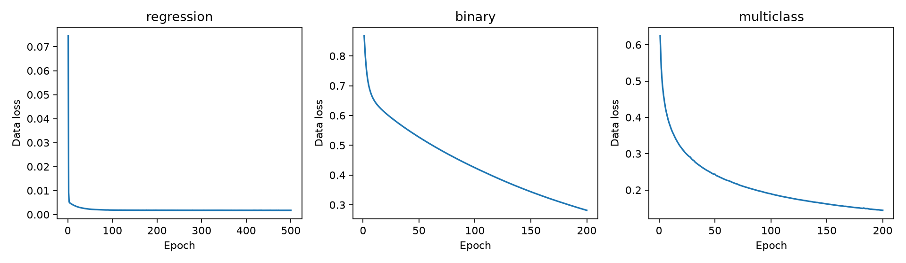
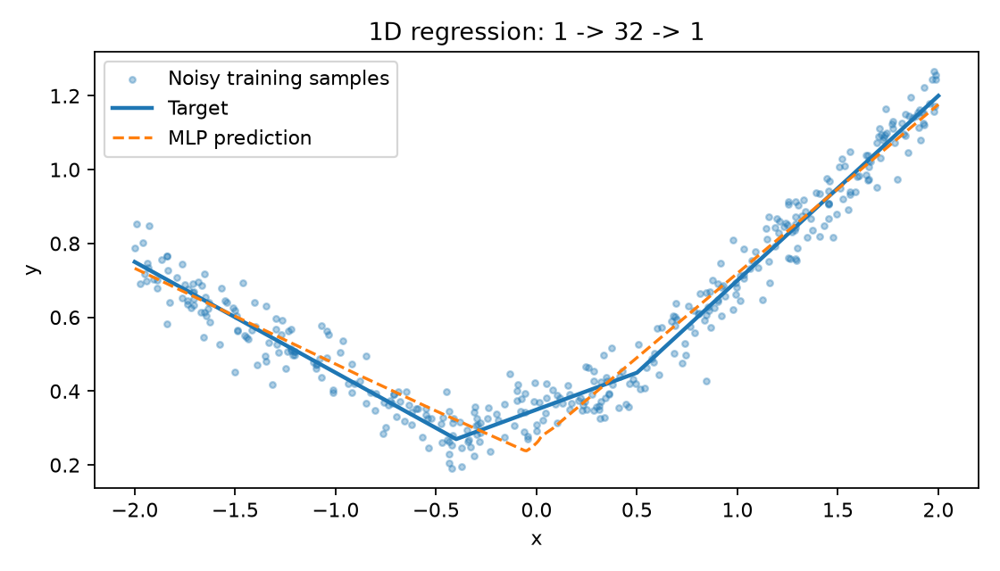
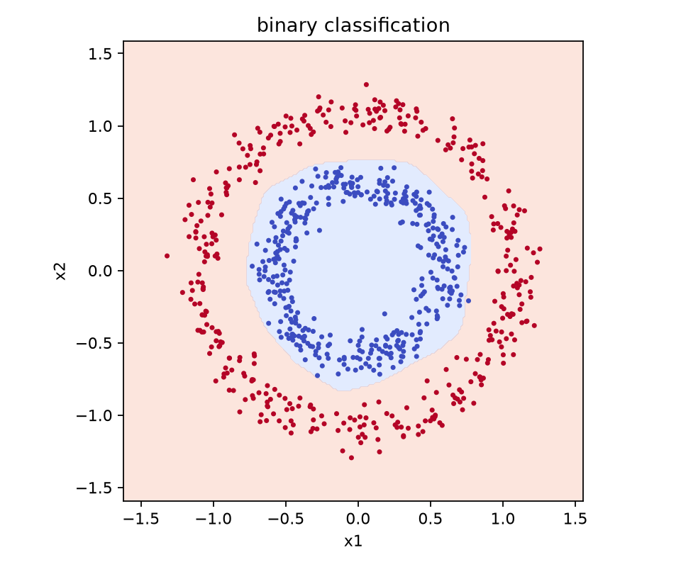
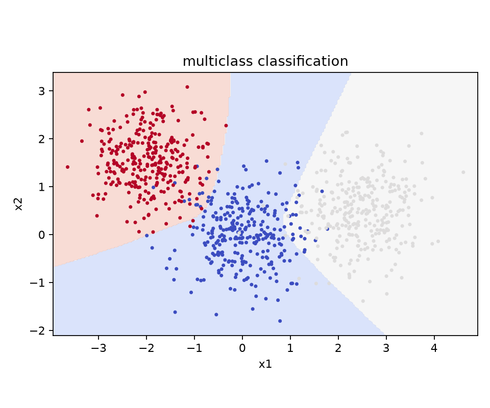

# Laboratory 7 - Part I: Basics

This report covers Part I on pages 1-10 of `lab7.pdf`: a NumPy MLP, SGD, backpropagation, and three application examples. All numerical results come from actual local execution. Parts II and III have not been started.

Part I contains implementation instructions, step-by-step explanations, and three application examples, rather than a separate numbered question list. Sections 1-4 explain the methods and results; Section 6 explicitly addresses the explanatory points in the lab so that the report answers them as well as presenting working code.

## 1. Objectives and Model

A perceptron computes a weighted sum of its inputs, adds a bias, and applies an activation function. An MLP connects these operations in layers. Nonlinear hidden activations allow the network to approximate piecewise-linear functions and nonlinear classification boundaries.

The implementation is in [src/part1.py](../src/part1.py). Following the PDF example code, the model has one hidden layer and two fully connected layers with trainable parameters:

```text
Input X -> Z1 = XW1 + b1 -> H1 = ReLU(Z1) -> Z2 = H1W2 + b2
Regression: return Z2 directly
Classification: return softmax(Z2)
```

The conceptual example on page 2 is `2 -> 4 -> 4 -> 2`, whereas the subsequent `MLP2` code and all three experiments have one hidden layer. This implementation follows the concrete code. "Two-layer" counts the two parameterized layers and excludes the input layer.

- `ReLU(z) = max(0, z)`. Its derivative is 1 for `z > 0` and 0 otherwise; the derivative at zero is taken as 0.
- Weights use He initialization as in the PDF; biases start at zero.
- Softmax subtracts each row's maximum before exponentiation to avoid overflow, then normalizes the outputs into probabilities.
- One-hot encoding represents each class label as a vector with 1 at the corresponding class index.
- The regression loss follows the PDF: `L = (1 / (2*N)) * sum_i sum_j (Z2[i,j] - y[i,j])**2`. With one output, this is half the ordinary MSE.
- The classification loss is mean cross-entropy: `L = -(1/N) * sum_i log(p[i,y[i]] + 1e-12)`.

## 2. Backpropagation and Training

The regression output gradient is `dZ2 = (Z2 - y) / N`. For Softmax combined with cross-entropy, it is `dZ2 = (p - one_hot(y)) / N`; the code adds `1e-12` inside the logarithm as a numerical safeguard. As in the PDF, the backward pass uses the standard Softmax/cross-entropy gradient, without differentiating that small safeguard. The remaining gradients are:

```text
dW2 = H1.T @ dZ2               db2 = sum(dZ2, axis=0, keepdims=True)
dH1 = dZ2 @ W2.T
dZ1 = dH1 * (Z1 > 0)
dW1 = X.T @ dZ1                db1 = sum(dZ1, axis=0, keepdims=True)
```

Here `@` denotes matrix multiplication, `.T` denotes transpose, and `*` denotes elementwise multiplication. Intermediate values `X`, `Z1`, and `H1` are cached during the forward pass because the backward pass needs them to apply the chain rule.

Each epoch shuffles the samples using `seed=epoch`, then performs a forward pass, backpropagation, and an SGD update for each mini-batch. Weight decay applies only to weights: `W = W - lr * (dW + weight_decay * W)`. Biases are updated as `b = b - lr * db`. The full training-set data loss is recorded after every epoch and excludes the L2 regularization term.

## 3. Experimental Setup

| Experiment | Network | Training samples | Epochs | Learning rate | Batch size | Weight decay | Data/model seeds |
| --- | --- | ---: | ---: | ---: | ---: | ---: | --- |
| 1D regression | 1 -> 32 -> 1 | 400 | 500 | 0.01 | 64 | 0.0001 | 0 / 1 |
| Concentric-ring binary classification | 2 -> 64 -> 2 | 800 | 200 | 0.005 | 64 | 0.0001 | 1 / 2 |
| Three-blob multiclass classification | 2 -> 64 -> 3 | 900 | 200 | 0.005 | 64 | 0 | 4 / 3 |

Regression inputs are sampled uniformly from `[-2, 2]`. The target is `f(x) = max(0, 0.5*x + 0.2) + 0.3*max(0, -x + 0.5)`, with additive Gaussian noise of standard deviation 0.05. The concentric rings have radii 0.6 and 1.1, with radial noise of standard deviation 0.07. The three Gaussian blobs have means `(0, 0)`, `(2.5, 0.5)`, and `(-2, 1.5)`, each with covariance `diag(0.4, 0.4)`.

These parameters, training data seeds, and model seeds match the PDF. An additional 2,000 ring samples (seed=101) and 3,000 blob samples (seed=104) are generated with different seeds and used only for evaluation after training. These independent synthetic test sets follow the same distributions as the training sets.

## 4. Recorded Results

| Experiment | Initial loss | Final loss | Training accuracy | Independent test accuracy | Training time (seconds) |
| --- | ---: | ---: | ---: | ---: | ---: |
| 1D regression | 1.076999 | 0.001775 | N/A | N/A | 0.1802 |
| Binary classification | 0.958286 | 0.281615 | 99.875% | 99.900% | 0.2156 |
| Multiclass classification | 1.778096 | 0.144010 | 95.111% | 95.233% | 0.2401 |

Timing uses `perf_counter()` and includes only `train()`, excluding plotting, testing, and dependency loading. Times vary with machine load. The recorded environment is Python 3.13.15 and NumPy 2.5.4; this part runs on the CPU using NumPy.



### 4.1 1D Regression

The ordinary training MSE is **0.00354938**. The MSE against the noiseless target on a uniform grid of 401 points is **0.00099166**.

| x | Noiseless target | Prediction |
| ---: | ---: | ---: |
| -2.0 | 0.750000 | 0.732648 |
| -1.5 | 0.600000 | 0.602820 |
| -1.0 | 0.450000 | 0.472992 |
| -0.5 | 0.300000 | 0.346200 |
| 0.0 | 0.350000 | 0.259591 |
| 0.5 | 0.450000 | 0.490820 |
| 1.0 | 0.700000 | 0.719437 |
| 1.5 | 0.950000 | 0.948054 |
| 2.0 | 1.200000 | 1.176670 |



Weighted combinations of hidden ReLU units form a piecewise-linear fit. The model learns the overall trend, but deviations remain near the target's breakpoints at `x=-0.4` and `x=0.5`, particularly an underestimate at `x=0`. The loss improves slowly late in training, indicating that the PDF's fixed training settings do not fully capture the breakpoints. These observed results are retained.

### 4.2 Concentric-Ring Binary Classification

The model classifies **799/800** training samples and **1998/2000** independent test samples correctly. The test confusion matrix uses rows for true classes and columns for predicted classes; class 0 is the inner ring and class 1 is the outer ring.

| True class / Predicted class | 0 | 1 |
| --- | ---: | ---: |
| 0 | 998 | 2 |
| 1 | 0 | 1000 |



A single straight line cannot separate the concentric rings. Multiple ReLU activation regions combine into an approximately closed polygonal boundary that separates the inner and outer rings. High accuracy can coexist with a cross-entropy of 0.281615 because a correct prediction does not require the true class probability to be close to 1.

### 4.3 Three-Blob Multiclass Classification

The model classifies **856/900** training samples and **2857/3000** independent test samples correctly.

| True class / Predicted class | 0 | 1 | 2 |
| --- | ---: | ---: | ---: |
| 0 | 902 | 50 | 48 |
| 1 | 29 | 971 | 0 |
| 2 | 16 | 0 | 984 |



ReLU units form multiple linear regions, and the three Softmax outputs provide class probabilities. Most errors occur between the central blob and the two outer blobs. The Gaussian distributions overlap, so perfect separation of every sample is not expected. Training and independent test accuracy are close, with no substantial generalization gap observed on this test distribution.

## 5. Verification and Reproduction

[scripts/verify_part1.py](../scripts/verify_part1.py) is an optional verification tool beyond the PDF requirements. It uses central finite differences to check every entry of `W1`, `b1`, `W2`, and `b2` in a small network for both regression and classification. It also verifies that large-magnitude logits produce finite, normalized Softmax probabilities.

| Check | Result |
| --- | --- |
| Maximum absolute regression gradient error | 2.27e-9; passed |
| Maximum absolute classification gradient error | 9.45e-11; passed |
| Softmax numerical stability | Passed |
| Finite losses and a decrease from the initial loss in all experiments | Passed |

Run directly from the project directory:

```powershell
python src/part1.py
python scripts/verify_part1.py
```

For another environment, install dependencies first. A project-local dependency directory can be used:

```powershell
python -m pip install --target .packages -r requirements.txt
python src/part1.py
python scripts/verify_part1.py
```

Raw results are stored in `results/part1/`: `metrics.json` (metrics and training parameters), `losses.csv` (per-epoch losses), `regression_predictions.csv`, two test confusion matrix CSV files, `run.log` (complete execution output), `verification.json`, and four PNG figures. Rerunning the scripts updates these artifacts.

## 6. Responses to the Lab's Explanatory Points

The prompts below organize the concepts discussed in Part I; they are not additional questions quoted from the PDF.

### 6.1 ANN and ReLU Basics (PDF pages 1-2)

**How does an MLP represent nonlinear relationships?** A single perceptron has a linear decision boundary. ReLU changes which hidden units are active for different inputs, so the MLP combines different linear mappings in different regions. Without nonlinear activations, stacking affine layers would still produce one affine mapping. More hidden units or layers can represent more complex relationships, but also increase computation and can make optimization harder. This MLP is feedforward and fully connected: each layer receives the previous layer's outputs, with no recurrence or convolution.

### 6.2 MLP Implementation and Training (PDF pages 2-9)

**Why do regression and classification use different outputs and losses?** Regression predicts continuous values, so it returns the raw output and minimizes squared error. Classification predicts a discrete label, so Softmax converts logits to class probabilities and cross-entropy penalizes low probability assigned to the true class. The predicted class is the index of the largest probability. Subtracting the maximum logit leaves Softmax probabilities unchanged while avoiding overflow.

**How does the model learn?** Each mini-batch follows the sequence forward pass, loss interpretation, backward pass, and SGD update. The implementation computes the gradients directly after the forward pass; evaluating the scalar loss separately is not needed for that update. Backpropagation applies the chain rule from the output through the second linear layer, the ReLU mask, and the first linear layer. SGD subtracts the learning rate times each gradient. The loss is then measured on the entire training set after each epoch to track progress. A sufficiently small step can reduce loss locally; mini-batch updates do not guarantee that loss decreases on every step.

**Why use He initialization, mini-batches, and weight decay?** He initialization uses weight variance `2 / fan_in` to help preserve signal scale through ReLU layers. Shuffled mini-batches reduce the amount of data processed per update and introduce gradient noise that can help optimization, without guaranteeing escape from every local minimum. The learning rate controls update size. Weight decay adds `weight_decay * W` to weight gradients, discouraging large weights; biases are not regularized in the PDF implementation.

### 6.3 Application Example 1: Piecewise-Linear Regression (PDF page 9)

**What do the ReLU units learn, and how well does the fit work?** Each hidden unit contributes a linear segment when active and zero when inactive. Their weighted sum approximates the target's piecewise-linear shape. Backpropagation adjusts the weights and biases to reduce squared error on noisy observations. With the specified 400 samples and 500 epochs, loss decreases from 1.076999 to 0.001775. The nine requested predictions appear in Section 4.1. The fit follows the overall function but underestimates the target at `x=0`; successful execution does not imply an exact fit.

### 6.4 Application Example 2: Nonlinear Binary Classification (PDF pages 9-10)

**Why can the network separate concentric rings?** A straight line cannot separate an inner ring from an outer ring. Hidden ReLU units divide the plane into regions whose combined decision boundary approximates a closed shape. This is a piecewise-linear approximation to a circular boundary. The two Softmax outputs provide class probabilities; cross-entropy trains the network to favor the correct class. Gradients flow through the Softmax/cross-entropy output, the second linear layer, ReLU, and the first linear layer. Training accuracy is 799/800, or 99.875%.

### 6.5 Application Example 3: Three-Class Classification (PDF page 10)

**How does the network distinguish three blobs?** The output layer has three logits, one for each class, and Softmax normalizes them to probabilities. Taking `argmax` assigns each input to one of the three classes. ReLU activation regions allow multiple linear pieces to separate the clusters. Training accuracy is 856/900, or 95.111%; Section 4.3 discusses errors where the sampled distributions overlap.

## 7. Completion Status

Part I is complete, including the implementation, all three example runs, recorded results, and explanations. There are no remaining blockers. Missing dependencies were resolved by installing them in the project's `.packages/` directory. Part I requires neither an image dataset nor a GPU. The cat/dog image experiments and GPU comparison belong to Parts II and III.
