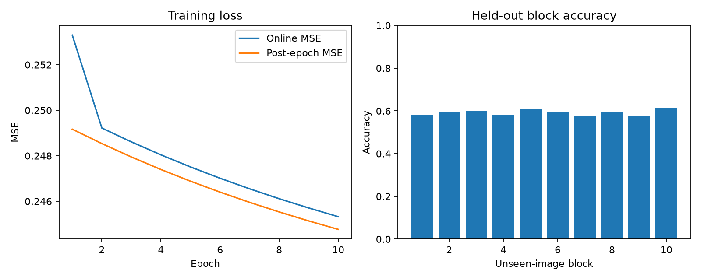

# Laboratory 7 Report - Parts I and II

This report covers Parts I and II of `lab7.pdf`. Sections 1-7 cover Part I (pages 1-10); Section 8 answers the Part II evaluation tasks (pages 10-12). All numerical results come from actual local execution. Part III has not been started.

Part I has no separate numbered question list. Sections 1-4 answer its explanatory points and discuss all three examples; Section 6 maps these responses to the PDF.

## 1. Objectives and Model

A perceptron applies an activation to a weighted input sum plus bias. An MLP connects these units in fully connected, feedforward layers. ReLU introduces nonlinearity; without it, stacked affine layers would remain a single affine mapping. More layers or neurons increase representational capacity and training cost.

The implementation is in [src/part1.py](src/part1.py). Following the PDF example code, the model has one hidden layer and two fully connected layers with trainable parameters:

```text
Input X -> Z1 = XW1 + b1 -> H1 = ReLU(Z1) -> Z2 = H1W2 + b2
Regression: return Z2 directly
Classification: return softmax(Z2)
```

The conceptual example on page 2 is `2 -> 4 -> 4 -> 2`, whereas the subsequent `MLP2` code and all three experiments have one hidden layer. This implementation follows the concrete code. "Two-layer" counts the two parameterized layers and excludes the input layer.

- `ReLU(z) = max(0, z)`. Its derivative is 1 for `z > 0` and 0 otherwise; the derivative at zero is taken as 0.
- Weights use He initialization with variance `2 / fan_in` to help preserve signal scale through ReLU; biases start at zero.
- Softmax subtracts each row's maximum before exponentiation to avoid overflow, then normalizes the outputs into probabilities.
- One-hot encoding represents each class label as a vector with 1 at the corresponding class index. Classification selects the largest Softmax probability using `argmax`.
- The regression loss follows the PDF: `L = (1 / (2*N)) * sum_i sum_j (Z2[i,j] - y[i,j])**2`. With one output, this is half the ordinary MSE.
- The classification loss is mean cross-entropy: `L = -(1/N) * sum_i log(p[i,y[i]] + 1e-12)`.

Regression returns continuous raw outputs and penalizes squared error. Classification returns class probabilities; cross-entropy penalizes low probability assigned to the true class.

## 2. Backpropagation and Training

Backpropagation applies the chain rule from the output through the second linear layer, ReLU, and the first linear layer. The output gradient is `dZ2 = (Z2 - y) / N` for regression and `dZ2 = (p - one_hot(y)) / N` for Softmax/cross-entropy. As in the PDF, the latter uses the standard gradient, ignoring the small `1e-12` logarithm safeguard. The remaining gradients are:

```text
dW2 = H1.T @ dZ2               db2 = sum(dZ2, axis=0, keepdims=True)
dH1 = dZ2 @ W2.T
dZ1 = dH1 * (Z1 > 0)
dW1 = X.T @ dZ1                db1 = sum(dZ1, axis=0, keepdims=True)
```

Here `@` denotes matrix multiplication, `.T` denotes transpose, and `*` denotes elementwise multiplication. Intermediate values `X`, `Z1`, and `H1` are cached during the forward pass because the backward pass needs them to apply the chain rule.

Each epoch shuffles samples using `seed=epoch`, then performs forward propagation, backpropagation, and SGD updates for each mini-batch. Mini-batches reduce per-update memory requirements and introduce gradient noise that can help optimization. The learning rate controls step size; loss need not decrease at every update. Weight decay discourages large weights using `W = W - lr * (dW + weight_decay * W)`; biases use `b = b - lr * db`. Full training-set data loss is measured after each epoch, excluding the regularization term.

## 3. Experimental Setup

| Experiment | Network | Training samples | Epochs | Learning rate | Batch size | Weight decay | Data/model seeds |
| --- | --- | ---: | ---: | ---: | ---: | ---: | --- |
| 1D regression | 1 -> 32 -> 1 | 400 | 500 | 0.01 | 64 | 0.0001 | 0 / 1 |
| Concentric-ring binary classification | 2 -> 64 -> 2 | 800 | 200 | 0.005 | 64 | 0.0001 | 1 / 2 |
| Three-blob multiclass classification | 2 -> 64 -> 3 | 900 | 200 | 0.005 | 64 | 0 | 4 / 3 |

Regression inputs are sampled uniformly from `[-2, 2]`. The target is `f(x) = max(0, 0.5*x + 0.2) + 0.3*max(0, -x + 0.5)`, with additive Gaussian noise of standard deviation 0.05. The concentric rings have radii 0.6 and 1.1, with radial noise of standard deviation 0.07. The three Gaussian blobs have means `(0, 0)`, `(2.5, 0.5)`, and `(-2, 1.5)`, each with covariance `diag(0.4, 0.4)`.

These parameters, training data seeds, and model seeds match the PDF. An additional 2,000 ring samples (seed=101) and 3,000 blob samples (seed=104) are generated with different seeds and used only for evaluation after training. These independent synthetic test sets follow the same distributions as the training sets.

## 4. Recorded Results

| Experiment | Initial loss | Final loss | Training accuracy |
| --- | ---: | ---: | ---: |
| 1D regression | 1.076999 | 0.001775 | N/A |
| Binary classification | 0.958286 | 0.281615 | 99.875% |
| Multiclass classification | 1.778096 | 0.144010 | 95.111% |

The recorded environment is Python 3.13.15 and NumPy 2.5.4 on CPU. As optional evaluation beyond Part I, independent ring and blob test accuracies are 99.900% and 95.233%, respectively. Detailed metrics and timings remain in [metrics.json](results/part1/metrics.json).


### 4.1 1D Regression

The ordinary training MSE is **0.00354938**. The MSE against the noiseless target on a uniform grid of 401 points is **0.00099166**.

| x | Noiseless target | Prediction |
| ---: | ---: | ---: |
| -2.0 | 0.750000 | 0.732648 |
| -1.5 | 0.600000 | 0.602820 |
| -1.0 | 0.450000 | 0.472992 |
| -0.5 | 0.300000 | 0.346200 |
| 0.0 | 0.350000 | 0.259591 |
| 0.5 | 0.450000 | 0.490820 |
| 1.0 | 0.700000 | 0.719437 |
| 1.5 | 0.950000 | 0.948054 |
| 2.0 | 1.200000 | 1.176670 |


Each ReLU unit is active over part of the x-axis, and their weighted sum forms a piecewise-linear fit. Backpropagation and SGD reduce squared error on noisy samples. The model learns the overall trend but does not fully capture the breakpoints at `x=-0.4` and `x=0.5`; at `x=0` it predicts 0.259591 instead of 0.35.

### 4.2 Concentric-Ring Binary Classification

The model correctly classifies **799/800** training samples (99.875%); class 0 is the inner ring and class 1 is the outer ring.


A single straight line cannot separate the concentric rings. Multiple ReLU activation regions combine into an approximately closed polygonal boundary that separates the inner and outer rings. High accuracy can coexist with a cross-entropy of 0.281615 because a correct prediction does not require the true class probability to be close to 1.

### 4.3 Three-Blob Multiclass Classification

The model correctly classifies **856/900** training samples (95.111%).


ReLU units form multiple linear regions to separate the clusters. Three Softmax outputs provide class probabilities, and `argmax` selects the predicted class. Most independent-test errors involve the central blob and an outer blob; overlapping Gaussian distributions make perfect separation unlikely.

## 5. Verification and Reproduction

Previously executed numerical checks are recorded in [verification.json](results/part1/verification.json): maximum regression and classification gradient errors were `2.27e-9` and `9.45e-11`, and the Softmax stability check passed. These are archived results; the optional verification scripts have been removed. All three experiments have finite losses below their initial values.

Run from the project root; dependency installation is needed only for a fresh environment:

```powershell
python -m pip install --target .packages -r requirements.txt
python src/part1.py
```

Raw evidence is in [metrics.json](results/part1/metrics.json), [losses.csv](results/part1/losses.csv), [regression_predictions.csv](results/part1/regression_predictions.csv), and [run.log](results/part1/run.log). Optional test confusion matrices and numerical checks are also retained under `results/part1/`.

## 6. Responses to the Lab's Explanatory Points

The PDF's explanatory points are answered in the sections below, without repeating the same discussion as a separate question list.

| PDF topic | Response in this report |
| --- | --- |
| ANN, MLP, and the role of ReLU (pages 1-2) | Section 1: weighted sums, nonlinearity, architecture, initialization |
| Forward pass, losses, backpropagation, SGD (pages 2-9) | Sections 1-2: outputs, loss functions, gradients, mini-batches, updates |
| Example 1: piecewise-linear regression (page 9) | Section 4.1: nine predictions, ReLU fit, error and limitations |
| Example 2: nonlinear binary classification (pages 9-10) | Section 4.2: accuracy and how a nonlinear boundary separates rings |
| Example 3: three-class classification (page 10) | Section 4.3: accuracy, Softmax/argmax, cluster separation and errors |

## 7. Part I Completion Status

Part I's NumPy MLP and all three application examples are implemented, executed, and explained above. Cat/dog image processing belongs to Part II; GPU comparison belongs to Part III.

## 8. Part II: NumPy Cat/Dog CNN

### 8.1 Dataset, Model, and Necessary Corrections

The PDF's [microsoft/cats_vs_dogs dataset](https://huggingface.co/datasets/microsoft/cats_vs_dogs/tree/b5ae3589204019bc2cc97e99e4914a54589333ef) contains 23,410 Parquet rows. After removing 24 byte-identical duplicates, a seeded, stratified 80/20 split produces:

| Split | Cat (0) | Dog (1) | Total |
| --- | ---: | ---: | ---: |
| Training | 9,380 | 9,328 | 18,708 |
| Unseen test | 2,346 | 2,332 | 4,678 |

Images are organized under `data/train/{cat,dog}/` and `data/test/{cat,dog}/`, converted to RGB, resized to 64x64, and normalized to `[0,1]`. The model uses one fixed random 3x3x3 convolution filter, ReLU, 2x2 max pooling, and a scalar FC output with ReLU. Only FC weights and bias are trained, using MSE, online SGD, learning rate 0.001, and 10 epochs. The class is dog when the output exceeds 0.5, otherwise cat. Split seed is 42; model and training-order seed is 0.

Two corrections are necessary: valid convolution and pooling produce `64 -> 62 -> 31`, so the FC input is `31*31 = 961`, rather than the PDF's `32*32*3`. Also, splitting the PDF's class-ordered loader directly would leave only dogs in the test set; stratification ensures both classes appear in each split. Exact-byte duplicates are removed before splitting, and no test images are used for training or model selection.

### 8.2 PDF Task: Automatically Train and Test Large Blocks of Unseen Images

[src/part2.py](src/part2.py) automatically trains on all 18,708 training images, then tests all 4,678 held-out images once, in nine blocks of 512 and one final block of 70. Each block runs image loading, preprocessing, convolution, pooling, and FC prediction. The fixed training features are computed once and reused across epochs; this preserves the FC-only updates. The convolution filter is verified to remain unchanged.

### 8.3 PDF Task: Measure Image Processing Time

Wall-clock times are measured with `perf_counter()` on CPU (Windows 11, Python 3.13.15, NumPy 2.5.4):

| Measurement | Result |
| --- | ---: |
| Training image loading, resizing, convolution, pooling | 166.4118 s |
| FC training and epoch metrics, all 10 epochs | 3.0306 s |
| Total training processing | 169.4424 s |
| Processing all 4,678 test images | 39.4744 s |
| Test throughput | 118.5072 images/s |
| Average test time per image | 8.4383 ms |

Test timings include reading, RGB conversion, resizing, normalization, convolution, pooling, FC inference, and thresholding. They exclude downloading and result-file/plot export. Training time includes the one-time feature extraction disclosed above. Timings depend on machine load and filesystem caching.

### 8.4 PDF Task: Report the Relevant Results

| Metric | Result |
| --- | ---: |
| Initial full training MSE | 0.497860 |
| Final online training MSE (epoch 10) | 0.245325 |
| Final full training MSE | 0.244767 |
| Training accuracy | 60.4875% |
| Test MSE | 0.245212 |
| Test accuracy | 58.9996% (2,760 / 4,678) |
| Test majority-class baseline | 50.1496% |

The online MSE averages losses before individual SGD updates; the full training MSE evaluates the final epoch model on the entire training set. Test confusion matrix (rows = true class, columns = predicted class):

| True / Predicted | Cat (0) | Dog (1) |
| --- | ---: | ---: |
| Cat (0) | 1,315 | 1,031 |
| Dog (1) | 887 | 1,445 |

| Test block | Images | Accuracy | Processing time (s) |
| --- | ---: | ---: | ---: |
| 1 | 512 | 58.0078% | 4.3097 |
| 2 | 512 | 59.3750% | 4.2407 |
| 3 | 512 | 60.1562% | 4.5574 |
| 4 | 512 | 58.0078% | 4.2756 |
| 5 | 512 | 60.7422% | 4.1946 |
| 6 | 512 | 59.5703% | 4.3030 |
| 7 | 512 | 57.4219% | 4.2533 |
| 8 | 512 | 59.5703% | 4.1899 |
| 9 | 512 | 57.8125% | 4.4904 |
| 10 | 70 | 61.4286% | 0.6598 |



Training MSE decreases, and test accuracy is about 8.85 percentage points above the majority-class baseline. Accuracy remains modest: only the FC layer learns, while the single random convolution filter cannot learn task-specific cat/dog features. Output ReLU can also produce zero gradients for inactive outputs, although none of the final test outputs was zero. The training/test accuracy gap is about 1.49 percentage points. Results use the epoch-10 model without test-based checkpoint selection.

The three Part II evaluation tasks are complete. Raw evidence is in [metrics.json](results/part2/metrics.json), [losses.csv](results/part2/losses.csv), [test_blocks.csv](results/part2/test_blocks.csv), and [test_predictions.csv](results/part2/test_predictions.csv). Reproduce preparation and training from the project root:

```powershell
python scripts/prepare_part2_data.py
python src/part2.py
```
